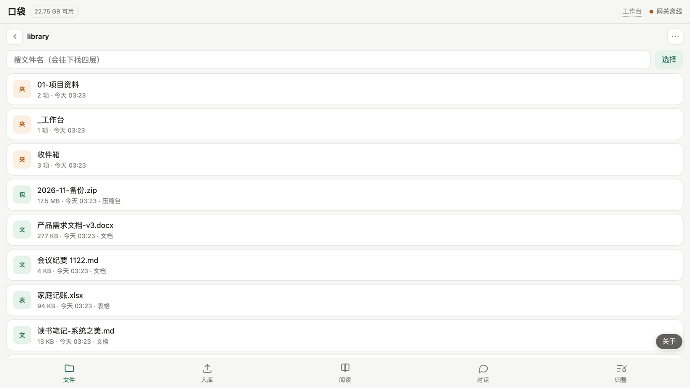
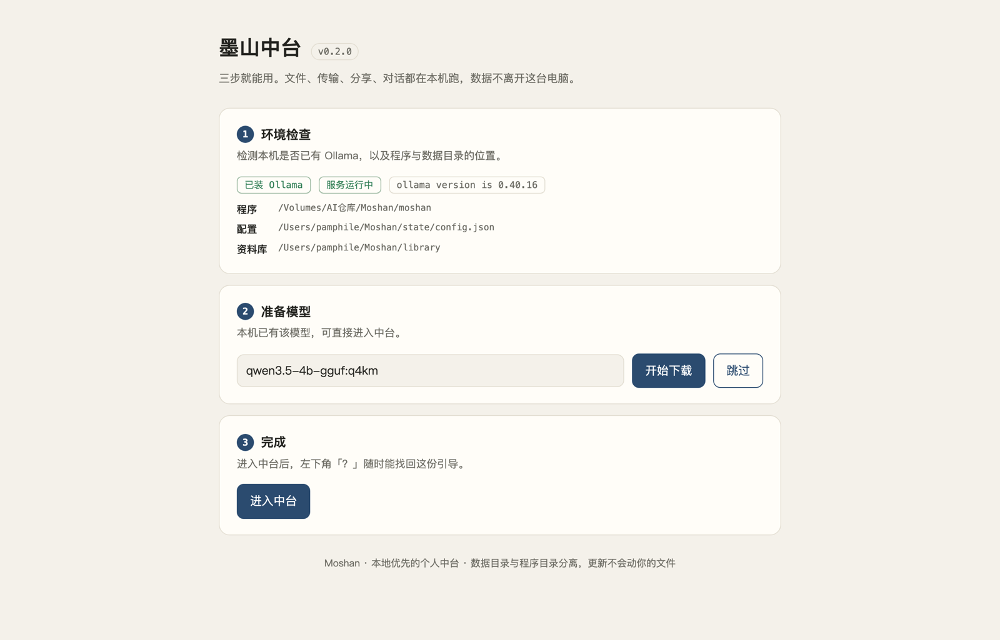
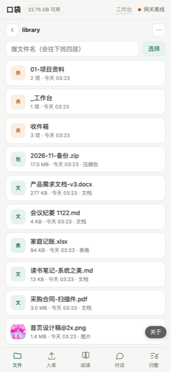
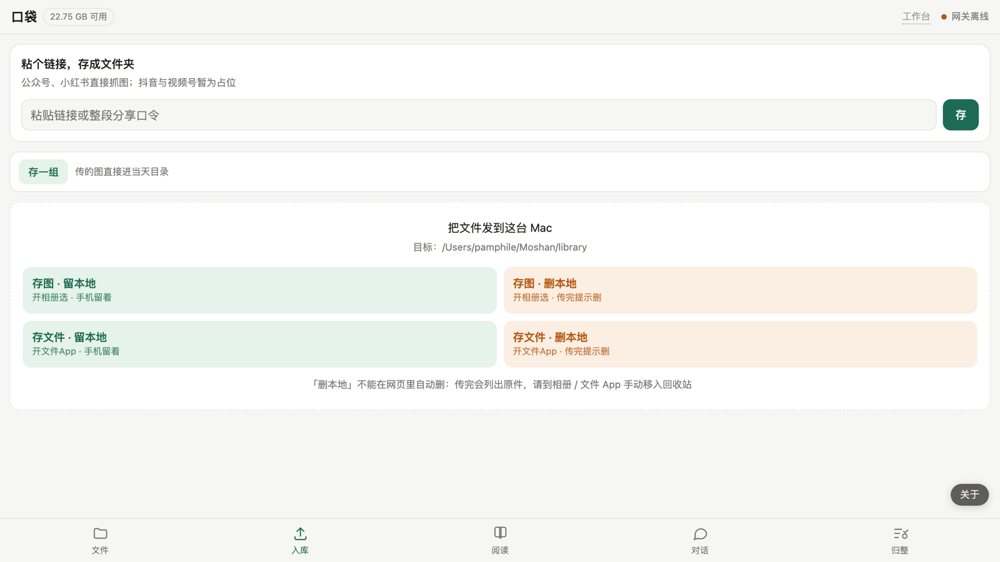
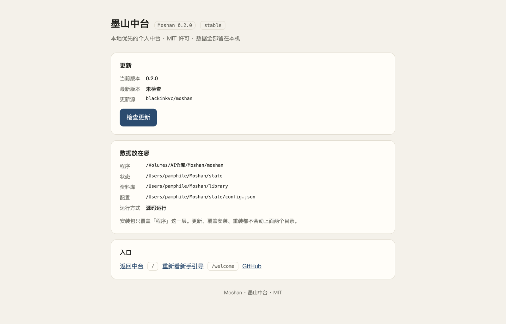

<div align="center">


<h1>墨山中台 · Moshan</h1>

<b>把一台电脑，变成你自己的中台</b>

<sub>文件管理 · 手机传文件 · 分享给朋友 · 网页存档 · 本地模型对话<br>
全部在这台电脑上跑，数据不出门</sub>

<br>

<a href="https://github.com/blackinkvc/moshan/releases/latest"></a>


</div>



> **不装 AI 也能用。** 文件、传输、分享、回收站、网页存档都不依赖模型；
> 模型只负责「对话」和「读文件问问题」，没有它这部分降级，其余照常。

**三层目录物理分离**是这项目最重要的设计：程序 / 状态 / 资料库各放一处，
覆盖安装只替换「程序」，所以升级、重装都不会动你的设置和文件 ——
不是靠代码小心，是目录结构决定的。

**服务端是一个 Rust 单二进制**（axum 0.8），220 条 HTTP 路由全部由它直接应答。
仓库里的 `moshan/*.py` 是同一套行为的 **Python 对照卷** —— 只在做逐字节对拍时启动
（`scripts/rust-parity.py`），不参与运行。所以安装包不需要 Python，也不需要 Node。

> 中文名「墨山中台」，英文名 Moshan（拼音，无同名软件）。

---

## 目录

- [它到底能干什么](#它到底能干什么)
- [下载安装](#下载安装)
- [第一次打开：三步引导](#第一次打开三步引导)
- [界面怎么用](#界面怎么用)
- [数据放在哪（也是「更新不丢东西」的原因）](#数据放在哪也是更新不丢东西的原因)
- [更新](#更新)
- [从源码运行](#从源码运行)
- [目录结构](#目录结构)
- [自己构建安装包](#自己构建安装包)
- [给 Agent 和脚本用的接口](#给-agent-和脚本用的接口)
- [安全模型](#安全模型)
- [常见问题](#常见问题)
- [已知限制](#已知限制)
- [参与开发](#参与开发)
- [许可](#许可)

---

## 它到底能干什么

| 能力 | 说明 | 要不要模型 |
|---|---|---|
| **文件管理** | 浏览器里浏览、上传、下载、重命名、移动、打包下载，按名称/时间/大小排序 | 不要 |
| **手机传文件** | 手机打开同一地址，选个文件就进电脑的「收件箱」；上传有进度、可中断 | 不要 |
| **分享给别人** | 给文件生成一条带令牌的链接，对方不用装软件，到期自动失效 | 不要 |
| **回收站** | 删除先进回收站，可还原；30 天后自动彻底清掉（天数可改） | 不要 |
| **网页存下来读** | 粘一条链接，服务端抓正文、留原文，抽出可读版本 | 不要 |
| **对话** | 接本机 Ollama，或任何 OpenAI 兼容端点（LM Studio / vLLM / 云 API） | 要 |
| **读文件问问题** | 让模型看收件箱里的文档（PDF / 文本）、网页正文，回答你的问题 | 要 |
| **WebDAV** | 打开后可以用系统「连接服务器」挂载资料库（默认关闭） | 不要 |

一句话：**不装模型也完全能用**，文件、传输、分享、回收站都不依赖模型；
只有「对话」和「读文件问问题」在没有模型时降级。

---

## 下载安装

到 [Releases](https://github.com/blackinkvc/moshan/releases) 下载对应系统的安装包：

| 系统 | 文件 | 说明 |
|---|---|---|
| macOS（Apple 芯片） | `Moshan-<版本>-macos-arm64.dmg` | M1 / M2 / M3 / M4 |
| macOS（Tauri 壳） | `Moshan_<版本>_aarch64.dmg` | 由 `tauri.yml` 构建，窗口化，仍拉起同一个本机服务 |
| Windows 10 / 11（64 位） | `Moshan-<版本>-windows-x64-Setup.exe` | 一键安装，无需管理员权限 |
| Windows（Tauri 壳） | `Moshan_<版本>_x64-setup.exe` | NSIS 安装包，按当前用户安装 |
| Linux（64 位） | `moshan_<版本>_amd64.deb` / `.AppImage` | Debian / Ubuntu 用 deb，其他发行版用 AppImage |
| Android | `Moshan-<版本>-android.apk` | **控制器**：不跑本机服务，连到已配对的桌面机 |
| 网页版 | 无需下载 | 服务跑起来后浏览器直接开 `http://127.0.0.1:<端口>` |

安装包自带服务端本体（Rust 编译的单文件），**不需要另外装 Python、也不需要装 Node**。

**网页版与桌面壳是同一个服务。** 桌面壳（Tauri）只负责开窗口、拉起本机服务端、
退出时收掉进程；业务与接口全在服务里。所以两者可以并存：壳开着的时候，浏览器打开同一端口
看到的是同一份数据，不存在「网页版和桌面版数据不同步」。想只用浏览器，装安装包后直接访问
`http://127.0.0.1:8323` 即可（端口以 `state/config.json` 里的 `local_port` 为准）。

**Android 是控制器，不是第二个本体。** 手机上跑不了桌面二进制（bionic 与 glibc 不兼容），
所以 APK 装完先填桌面机地址、端口与令牌，之后加载对方的中台页面。桌面机需通过 Tailscale
或局域网可达：Tailscale 走 `plain_port`（默认 8322），局域网需放开 `allow_lan` 并把手机加进
`lan_allow_ips`。手机一律走明文 HTTP —— 安卓不信任自签证书。


<details>
<summary><b>macOS 提示「无法验证开发者」怎么办</b></summary>

安装包没有 Apple 付费开发者签名（$99/年），这是系统对未签名应用的固定行为，**不是文件损坏**。

任选一种，只需一次：

- 访达里 **右键点 Moshan → 打开 → 再点「打开」**
- 或「系统设置 → 隐私与安全性」，页面下方点「仍要打开」
- 或终端执行：`xattr -dr com.apple.quarantine /Applications/Moshan.app`

</details>

<details>
<summary><b>Windows 提示「Windows 已保护你的电脑」怎么办</b></summary>

同样是未做代码签名导致的 SmartScreen 提示。点「更多信息 → 仍要运行」即可，只需一次。

安装程序本身按当前用户安装（`PrivilegesRequired=lowest`），不会弹 UAC、不写系统目录。

</details>

**没有 Intel Mac 的安装包**：CI 只为 Apple Silicon 构建 —— `macos-13`（Intel）运行器
已被 GitHub 列入退役计划，放进矩阵会让整个发布流程因「runner 不存在」而失败。
需要 Intel 包时在 Intel 机器上跑一次 `bash packages/macos/build.sh` 即可，脚本本身两平台通用。

---

## 第一次打开：三步引导

装完直接启动，浏览器自动打开 `/welcome`。**引导在软件里，不在安装器里** —— 这样
「装完等下载」的阶段你能看见进度，而不是对着一个不动的安装窗口猜它卡在哪。

1. **环境检查**
   显示程序目录、状态目录、资料库目录（确认三者分开），并探测本机是否已有 Ollama。

2. **准备模型（可选，可跳过）**
   检测到 Ollama → 一键 `pull` 模型（约 2.4 GB，自带断点续传，进度实时回显）。
   没有 Ollama → 可跳过，或改填任意 OpenAI 兼容端点。
   模型放 Ollama 自己的目录，**卸载重装 Moshan 不会重复下载**。

3. **进入中台**
   打开工作界面。之后左下角 **?** 随时能找回这份引导，也可以直接访问 `/welcome`。

> 引导页本身免令牌，但仍受网络守卫保护：只对本机与 Tailscale 来源开放。



---

## 界面怎么用

启动器会打印这样几行（端口被占会自动顺延，所以数字可能不同）：

```
口袋服务 http://127.0.0.1:8323/?k=<令牌>   （本机用这个，无证书警告）
口袋服务 https://127.0.0.1:8321
         https://<机器名>.<tailnet>.ts.net:8321/?k=<令牌>
访问令牌 <令牌>
```

- **本机**：用 `http://127.0.0.1:8323/?k=...`，明文端口，没有证书警告。
- **手机 / 另一台电脑**：用 `https://<隧道地址>:8321/?k=...`，第一次会提示自签证书，
  点「继续」即可。控制台里打印的就是完整可用地址，复制过去就能开。
- 令牌丢了：看状态目录里的 `config.json`（`token` 字段），或跑
  `python moshan/show_token.py`，它会把地址、令牌、证书、WebDAV 状态一起打出来。

### 底部五个标签

| 标签 | 干什么 |
|---|---|
| **文件** | 浏览、上传、下载、重命名、移动到、打包下载、生成带有效期的分享链接、回收站 |
| **入库** | 粘一条链接抓成存档；或把手机上的文件直接发到这台电脑 |
| **阅读** | 抓下来的网页正文，在这里读 |
| **对话** | 接本机模型或任意 OpenAI 兼容端点，能带着收件箱里的文件问问题 |
| **归整** | 去重清单：挑出重复的图与文件，留一份，其余移入回收站 |

顶部是当前路径（面包屑）与磁盘可用空间，行尾「…」是这一行文件的操作菜单。

<p align="center">
  
  <br>
  <sub>手机打开同一个地址，界面自动收成单列</sub>
</p>



---

## 数据放在哪（也是「更新不丢东西」的原因）

| 哪一层 | macOS | Windows | 里面装什么 | 更新时 |
|---|---|---|---|---|
| **程序** | `/Applications/Moshan.app` | `%LOCALAPPDATA%\Programs\Moshan` | 代码与运行时 | 整体替换 |
| **状态** | `~/Library/Application Support/Moshan` | `%APPDATA%\Moshan` | 配置、令牌、证书、日志、下载缓存 | **不动** |
| **资料库** | `~/Documents/Moshan` | `%USERPROFILE%\Documents\Moshan` | 你的文件、收件箱、回收站、工作台页面 | **不动** |

安装包只覆盖「程序」这一层。所以覆盖安装、升级、卸载重装，你的设置和文件都原样还在。

- **想换机器**：拷走「状态」和「资料库」两个目录，程序重装一次即可。
- **想彻底删干净**：三个目录一起删。
- **想自定义位置**：用环境变量 `MOSHAN_HOME` 指定一个根，三层目录会在它下面重建（测试用）。

资料库里的子目录是固定的，一眼就能找到东西：

```
收件箱/        手机传进来的、还没归整的
04-存图/       粘链接存下来的图集
08-阅读/       存下来的文章，按主题分文件夹
10-系统记录/   心跳、磁盘水位、使用报告（工作台的卡片读这里）
_工作台/       工作台页面
.回收站/       删掉的东西，30 天后自动清
```

这些目录都在**资料库**里，不在你的 `Documents` 根下另起炉灶——卸载、重装、
换版本都不会碰它们。

---

## 更新

界面**右下角有个「关于」**，点进去是 `/about`：版本、数据目录、检查更新都在这一页。
后台每 6 小时自己查一次 GitHub Release，**有新版本时这个入口会直接变成橙色的
「新版本 x.y.z」**，不用你主动去点。

> 被主机钉成 `update.mode = push` 的机器不查 GitHub（见下节），这条自动检查会让位给主机推送。

更新流程：

1. 有新版本 → 显示版本号、更新说明、安装包体积
2. 点下载 → 边下边算 sha256，与 GitHub 给出的资产 digest 比对
3. **校验不一致立刻丢弃**，不会让你装上一个损坏或被替换的包
4. 校验通过 → 点「打开安装包」，按系统流程覆盖安装
5. 装完重开，配置与文件原样

> 想手动下载、自己核对？Release 页面上的 `release.json` 里有每个包的 `size` 与
> `sha256`，与 GitHub API 资产 `digest` 同值。所以附件里不会再单独放一个 `.sha256`。
>
> ```bash
> shasum -a 256 Moshan-<版本>-macos-arm64.dmg    # 与 release.json 里的值对比
> ```



下载的包留在状态目录的 `updates/` 下（只保留最近两个），所以「今天下载、明天再装」
也不会白下。命令行同样能查：

```bash
python moshan/updater.py --check      # 只看有没有新版
python moshan/updater.py --download   # 下载并校验，不安装
python moshan/updater.py --apply      # 下载、校验、打开安装包
```

### 主机推送（连不上 GitHub 的机器）

有些机器根本连不上 github.com（内网、机房、办公室那台），让它们自己去 Release 拉包，
界面上就是一个**必然失败**的按钮。这类机器改成由主机推：主机把包推过去，落盘、校验、
备份、替换、重启一条链走完，不用人到机器前。

```bash
# 直连：目标机端口可达
python scripts/host_push_update.py --http http://192.168.0.103:8321 --token <令牌>

# 走虫巢：目标机没有入站端口（只能往外轮询）也能更新
python scripts/host_push_update.py --fleet evox2 --fleet-token <虫巢令牌> --token <令牌>

# 把这台机器钉成「只认主机推送」，以后它不再查 GitHub（8 秒超时那种白等）
python scripts/host_push_update.py --http http://<地址>:8321 --token <令牌> --set-mode push

# 看当前是哪个版本、上次谁推的、备份在哪
curl -H "X-Token: <令牌>" http://<地址>:8321/api/update/status
```

推送过程的安全边界：分片上传 → 落地算 sha256 → **不符就整包丢弃**（不落半成品）→
解包只认程序文件白名单、拒绝绝对路径与 `..` → 备份当前程序目录 → 原地替换 →
重启 → 出问题 `POST /api/update/rollback` 退回上一版。

**为什么 GitHub 那条路不做「热替换运行中的程序」**：macOS 上 `.app` 运行时无法安全替换自身，
Windows 上运行中的 exe 被锁。强行做要「拉新进程 → 旧进程自杀 → 失败回滚」三段式，
任一段出错就是半个坏软件。所以走 GitHub 的机器仍然是「下载 → 校验 → 交给系统安装器」，
失败也破坏不了现有安装。

主机推送那条路确实是原地替换（源码部署没有安装包可交给系统），但它把这套风险显式兜住了：
替换前先整目录备份、sha256 不符整包丢弃、解包只认白名单、重启脚本把环境变量显式带上
（不然重启后服务会以空 profile 起来，读不到自己的配置）、失败可一键 rollback。

---

## 从源码运行

需要 Rust（stable）。服务端已全量 Rust 重写，源码态起服务只要一条命令：

```bash
git clone https://github.com/blackinkvc/moshan.git
cd moshan
cargo run --release --manifest-path rust/Cargo.toml
```

自举做四件事：建目录骨架 → 发令牌 → 选一个可用端口 → 写 `state/config.json`；
加 `MOSHAN_OPEN=1` 会再开一次浏览器。

调试时常用开关：

```bash
MOSHAN_OPEN=1 cargo run --release --manifest-path rust/Cargo.toml   # 启动后开浏览器
MOSHAN_HOME=/tmp/moshan-test cargo run --release --manifest-path rust/Cargo.toml  # 数据全放临时目录
MOSHAN_NO_SCHED=1 cargo run --release --manifest-path rust/Cargo.toml  # 关掉后台循环
```

桌面壳：`bash scripts/stage-sidecar.sh && cd src-tauri && cargo tauri build`。

旧 Python 实现仍在 `moshan/` 里，用途只有一个：当逐字节对拍的对照组
（`python3 scripts/rust-parity.py --all-get --seed`）。它不再是运行路径。

跑一遍自检（语法、导入冒烟、硬编码路径扫描、版本号一致性）：

```bash
bash scripts/check.sh
```

---

## 目录结构

```
rust/
  Cargo.toml            工作区，锁定依赖版本
  moshan-server/        服务端本体（axum），220 条路由全在这里应答
    src/
      main.rs           装配路由 + 自举 + 角色开关
      boot.rs           首启：建目录、发令牌、选端口、写 config.json
      paths.rs          三层目录口径 —— 路径只许从这里取，别处不许拼
      auth.rs           三令牌通道（header → ?k= → cookie）
      storage.rs        文件层：路径守卫、回收站、分享、缩略图
      imaging.rs        缩略图 / HEIC 转 JPEG（mac 用 sips，其它平台探测外挂工具）
      sysopen.rs        打开文件 / 网址 / 在文件管理器里定位（三平台各一套命令）
      jsonio.rs         Python 风格 JSON 读写（indent=N，逐字节对齐）
      live/             进程内运行态：调度器写、HTTP 处理器读
      hostwork/         会话与工作量采集层（多张卡共用同一份数）
      routes/           按泳道分文件：w1…w7b / u，见 docs/RUST-LANES.md
moshan/                 原 Python 实现，现在是「对照卷」，只在逐字节对拍时启动
  ui.html               主界面（单文件，无构建步骤）
  dash.html             工作台页面的源（数据根里那份由它同步）
  version.py            版本号，与 VERSION 同值
src-tauri/              桌面壳（mac / win / linux），只负责开窗与托管 sidecar
packages/
  macos/build.sh        旧的 PyInstaller 打包（Python 兜底线）
  windows/build.ps1     同上，Windows
scripts/
  stage-sidecar.sh      把 Rust 二进制按 target triple 放进 src-tauri/binaries/
  tauri-build.sh        本机打包（自动把 target/ 挪到 APFS，避开 ._ 元数据）
  rust-parity.py        与 Python 卷逐字节对拍（--all-get --seed）
  rust-coverage.py      路由覆盖：Rust 自应答 / 仍依赖 Python 各多少条
  check.sh              本地自检，与 CI 检查项对齐
  bump-version.sh       改版本号（VERSION / version.py / CHANGELOG）
docs/
  ARCHITECTURE.md       分层、端口策略、更新流程
  RUST-LANES.md         Rust 迁移的泳道划分与施工顺序
  WINDOWS-PARITY.md     三平台能力差异与补法
.github/workflows/
  ci.yml                推代码 → 语法、冒烟、版本一致、密钥与路径扫描
  build.yml             打 v* 标签 → PyInstaller 安装包（旧线，仍可用）
  tauri.yml             打 v* 标签 → 桌面壳与移动壳，作为额外资产
```

界面是**单文件 HTML**，没有前端构建步骤：改 `moshan/ui.html` 或 `moshan/dash.html`，
刷新页面即可见效果。改 Rust 则要重新 `cargo build --release`；桌面壳装过的机器还得换一次
sidecar（`bash scripts/stage-sidecar.sh --reuse` 之后重启壳）。

---

## 自己构建安装包

服务端是 Rust、壳是 Tauri，两条命令：

```bash
bash scripts/stage-sidecar.sh     # cargo build --release，产物按 target triple 放进 src-tauri/binaries/
bash scripts/tauri-build.sh       # 出 .app / .dmg（mac）、nsis（win）、deb / AppImage（linux）
```

只想验证服务端、不要安装包：

```bash
cargo build --release --manifest-path rust/Cargo.toml
bash scripts/tauri-build.sh --no-bundle      # 编二进制，不打包
```

`tauri-build.sh` 会先看仓库所在盘：不是 APFS / HFS 时把 `target/` 指到本机盘。
在移动硬盘上直接 `cargo tauri build` 会被 exFAT 撒的 `._xxx` 噎住，报
「stream did not contain valid UTF-8」—— 看起来像配置写错了，其实是文件系统。

旧的 PyInstaller 线仍保留，只在需要对照 Python 实现时用：
`bash scripts/stage-sidecar.sh --python`、`bash packages/macos/build.sh`、
`powershell -File packages\windows\build.ps1`。**Windows 的 exe 只能在 Windows 上构建**，
那条线一直交给 CI。

发版流程：

```bash
bash scripts/bump-version.sh 0.4.0    # 改 VERSION / version.py / CHANGELOG
                                      # 另两处要手改：src-tauri/tauri.conf.json、rust/Cargo.toml
bash scripts/check.sh                 # 自检（会校验四处版本号一致）

git switch -c release/0.4.0           # main 有 ruleset，必须走 PR
git commit -am "chore: 0.4.0" && git push -u origin release/0.4.0
# 开 PR → 合并 → 再打标签
git tag -a v0.4.0 -m "Moshan 0.4.0" && git push origin v0.4.0
```

推 `v*` 标签后 Actions 自动构建、跑冒烟与校验，把安装包发到 Release，
同时生成一份 `release.json`（体积与 sha256 清单，供人工核对）。两个 job 全绿才算发完。

---

## 给 Agent 和脚本用的接口

所有接口都在 `/api/agent/*`，用同一个访问令牌鉴权（本机回环来源免令牌）：

| 接口 | 作用 |
|---|---|
| `GET /api/agent/schema` | 自描述：有哪些接口、要什么参数 |
| `GET /api/agent/brief?days=7` | 一份给 agent 看的「现在什么情况」 |
| `POST /api/agent/event` | 记一条会话事件（进 agent 总线） |
| `POST /api/agent/usage` | 记一笔 token 用量 |
| `GET /api/agent/read?ns=all&since=7d` | 读总线 |
| `GET /api/agent/link/scan` | 扫本机装了哪些 Agent、技能目录在哪 |
| `GET /api/agent/link/prompt` | 生成给那个 Agent 的接入说明书 |
| `POST /api/agent/link/install` | 把说明书写进它的技能目录（一次装好，长期生效） |
| `POST /api/agent/link/report` | Agent 回执：它把数据放哪了 |
| `POST /api/agent/link/import` | 按回执把它的账导进中台 |
| `POST /api/trae/note` | Trae 自报一笔「这轮干了什么 + 用量」，进工作台的 TRAE 卡 |

> **Trae 这边不用手动接**：`~/.trae-cn` 存在时，启动会把 `pocket-bridge` 技能写进
> Trae 的技能目录（版本变了才重写），Trae 下次开会话就知道往 `/api/trae/note` 报账。
> 想自己看一眼那段说明书：`curl -s http://127.0.0.1:8323/api/agent/link/prompt?agent=trae`。

还有 `GET /api/sys`（内存 / CPU / 负载 / 运行时长，轻量，适合轮询）、
`GET /api/status`（完整状态，较重）和 `GET /api/llm`（本机在跑什么大模型：
模型名 / 参数量 / 量化 / 上下文 / 端口 / 占用内存）。

```bash
# 例子：本机查一句
curl -s http://127.0.0.1:8323/api/sys
# {"ok":true,"at":"...","mem":{"pct":62.1,"used_gb":10.0,"total_gb":16.0,...},...}
```

---

## 安全模型

| 面 | 做法 |
|---|---|
| **网络入口** | 只接受本机回环与 Tailscale 隧道来源；公网一律拒绝（端口转发也没用），局域网默认同样拒绝，可用 `allow_lan` 临时放开并按 IP 白名单收窄 |
| **鉴权** | 每次请求带访问令牌（`X-Token` 头或 `?k=`）；令牌在首启时随机生成，存状态目录，权限 600 |
| **传输** | 隧道侧走 HTTPS，证书首次启动自签（这就是手机第一次要点「继续」的原因）；本机明文端口只绑回环 |
| **数据** | 全部落本机。依赖里没有任何遥测库 |
| **出站请求** | 只有两类：访问你自己配的模型端点；查更新（一个 GET 到 GitHub API，启动后 90 秒一次、之后每 6 小时一次，也可在「关于」页手动触发） |
| **校验** | 更新包边下边算 sha256，与 GitHub 资产 digest 比对，不一致即丢弃 |

局域网默认被挡是刻意的：同网段的人可能替换掉你访问的页面。要临时给平板/电视用，
把 `config.json` 里的 `allow_lan` 设为 `true`，并把 `lan_allow_ips` 填成具体设备 IP。

---

## 常见问题

**端口被占用怎么办**
不用管。明文端口从 8323 起、HTTPS 主端口从 8321 起，各自探测，被占就往后顺延，
实际端口会写回配置并打印在控制台。

**没有模型能用吗**
能。文件浏览、上传下载、分享、回收站、网页存档都不依赖模型，只有对话降级。

**手机上能用吗**
能。装 Tailscale 后手机和电脑在同一 tailnet，用控制台打印的 `https://<机器名>...ts.net:8324/?k=...` 访问。
不建议把端口直接映射到公网 —— 网络守卫会拒绝，这是设计如此。

**缩略图在 Windows 上没有**
macOS 用系统自带 `sips` 缩图；Linux / Windows 没有这个命令，会依次试 ImageMagick
（`magick` / `convert`）和 `ffmpeg`，装了其中一个就有缩略图，都没装就退回显示原图。
`/api/thumb` 与记账卡片图那两条接口在非 mac 上仍然直接回原图（实现还在旧的
`storage.rs` 里），列表内联缩略图和换图已经支持外挂工具。已知降级，不影响功能。

**工作台页面（`/dash`）打不开**
`/dash` 读的是资料库里的 `_工作台/dash.html`，你自己放一个 HTML 进去就能用；
没放就返回 404 并告诉你应该放在哪。它不随安装包分发。

**会不会偷偷上传我的数据**
不会。没有账号体系也没有遥测。出站请求只有两类：你自己配的模型端点，
以及查更新（一个 GET `api.github.com`，只带版本号，不带任何使用数据）。
不想让它自动查，把 `config.json` 里的 `update.auto` 设为 `false` 即可。

**卸载干净要删什么**
删程序（拖到废纸篓 / 卸载程序），再按需删状态目录与资料库目录（见[数据放在哪](#数据放在哪也是更新不丢东西的原因)）。

---

## 已知限制

- **依赖 cuntu 扩展的功能是降级状态**：粘链接抓正文、存图、OCR 依赖作者自己的
  cuntu 插件集（未随包分发）。不装时这些入口会明确报「没有 cuntu」而不是把服务拖崩；
  想用就把 `MOSHAN_CUNTU` 指向自己的副本。
- **macOS 未公证**，首次需右键打开（见上方折叠说明）。
- **Windows / Linux 上的降级**：缩略图要装 ImageMagick 或 ffmpeg 才有（没装就显示原图，
  `/api/thumb` 仍只有 mac 支持）；HEIC 转 JPEG 只有 mac 能做；打包下载在非 mac 上由
  `zip` crate 生成，解压结果与 Python 一致但压缩包容器字节可能不同。
  「打开目录 / 在 Finder 里定位」三平台都可用（mac `open`、Linux `xdg-open`、
  Windows `explorer`/`start`）。**Windows 无 OCR**（WinRT 那套还没接）、
  **视频封面不可用**（需 ffmpeg）。哪块用什么补、要不要额外装东西，见
  [`docs/WINDOWS-PARITY.md`](docs/WINDOWS-PARITY.md)。
- **暂无 Intel Mac 官方包**（CI 只构 arm64，可本地自建）。
- **暂无 Linux 包**：服务端、打开目录/定位、解压打包都已三平台化；仍带 macOS 语义的只剩
  应用启动器（`/api/apps` 的 `.app`/`open -a`）、HEIC 转码和 `/api/thumb` 缩略图。
- **更新不是原子替换**：走 GitHub 的那条交给系统安装器；走主机推送的那条是原地替换
  （有备份、sha256 校验、白名单解包、一键 rollback），但替换途中进程是停的。
- **无托盘图标**：关闭浏览器标签不会退出服务，要退出请从启动器窗口 `Ctrl+C`，或结束进程。
- **0.2.0 的用户请手动重下 0.2.2**：0.2.0 的安装版缺 CA 证书，任何 https 请求
  （包括「检查更新」本身）都会失败，没法自动升上来；Windows 包还叠加了首次启动崩溃。
  这两处都是 0.2.2 修掉的，详见 [CHANGELOG](CHANGELOG.md)。

---

## 参与开发

欢迎 issue 与 PR。动手前请先看：

- [`docs/ARCHITECTURE.md`](docs/ARCHITECTURE.md) —— 为什么这么分层、几个关键取舍
- [`docs/WINDOWS-PARITY.md`](docs/WINDOWS-PARITY.md) —— mac 与 Windows 的能力差异怎么补
- [`docs/SYNC.md`](docs/SYNC.md) —— 本仓库与上游开发目录的同步规则（哪些文件带补丁）
- [`CONTRIBUTING.md`](CONTRIBUTING.md) —— 提交前要跑什么

改代码请守住三条底线：

1. **路径只能从 `rust/moshan-server/src/paths.rs` 取**，任何模块里都不许拼
   `~/Documents/...` 这种字符串 —— 这是「别人装了也能跑」的前提，CI 会扫描硬编码家目录。
2. **不要在程序目录写运行时数据**，配置、日志、缓存一律进状态目录，用户文件进资料库。
3. **改了路由行为，跑一遍对拍**：`python3 scripts/rust-parity.py --all-get --seed`。
   Rust 与 Python 卷对同一份状态要回同样的字节；差异是有意的话，写进
   `docs/ARCHITECTURE.md` 的已知边界，别让它悄悄漂移。

---

## 许可

本项目采用 **MIT OR Apache-2.0 双许可**，你可以任选其一：

- [MIT](LICENSE-MIT)
- [Apache-2.0](LICENSE-APACHE)

选择 Apache-2.0 时，额外获得明确的专利授权条款；选择 MIT 时条款更短。
除特别标注的文件外，两种许可对全部代码同等适用。

© Moshan contributors
